<picture>
  <source media="(prefers-color-scheme: dark)" srcset="assets/banner-dark.svg">
  <source media="(prefers-color-scheme: light)" srcset="assets/banner-light.svg">
  
</picture>

[English](README.md) | Bahasa Indonesia

Saya kuliah Teknologi Rekayasa Perangkat Lunak di Universitas Gadjah Mada, Yogyakarta, dan membangun produk dari ujung ke ujung: model data, API, antarmuka, deployment, plus model AI bila memang layak dipakai. Platform pendaftaran, sistem inventori, dan aplikasi mobile yang dipakai orang sungguhan, bukan sekadar demo.

<picture>
  <source media="(prefers-color-scheme: dark)" srcset="assets/whoami-id-dark.svg">
  <source media="(prefers-color-scheme: light)" srcset="assets/whoami-id-light.svg">
  
</picture>

### Aktivitas

<picture>
  <source media="(prefers-color-scheme: dark)" srcset="assets/stats-dark.svg">
  <source media="(prefers-color-scheme: light)" srcset="assets/stats-light.svg">
  
</picture>

Digambar dari data GitHub publik saya oleh workflow harian ([`scripts/stats.mjs`](scripts/stats.mjs)). Tanpa widget pihak ketiga.

### Karya

Yang dipakai orang sungguhan, atau bisa dipakai. Ketuk kartunya.

<table>
  <tr>
    <td width="50%"><a href="https://kost3g.ghanizulhusni.space">
<picture>
  <source media="(prefers-color-scheme: dark)" srcset="assets/cards/kost3g-dark.svg">
  <source media="(prefers-color-scheme: light)" srcset="assets/cards/kost3g-light.svg">
  
</picture>
</a></td>
    <td width="50%"><a href="https://github.com/Ghanz08/glideslope-app">
<picture>
  <source media="(prefers-color-scheme: dark)" srcset="assets/cards/glideslope-dark.svg">
  <source media="(prefers-color-scheme: light)" srcset="assets/cards/glideslope-light.svg">
  
</picture>
</a></td>
  </tr>
  <tr>
    <td width="50%"><a href="https://github.com/Ghanz08/glideslope-android">
<picture>
  <source media="(prefers-color-scheme: dark)" srcset="assets/cards/android-dark.svg">
  <source media="(prefers-color-scheme: light)" srcset="assets/cards/android-light.svg">
  
</picture>
</a></td>
    <td width="50%"><a href="https://techenthusiastday.id">
<picture>
  <source media="(prefers-color-scheme: dark)" srcset="assets/cards/ted-dark.svg">
  <source media="(prefers-color-scheme: light)" srcset="assets/cards/ted-light.svg">
  
</picture>
</a></td>
  </tr>
  <tr>
    <td width="50%"><a href="https://ghanizulhusni.com/projects/sibudaya">
<picture>
  <source media="(prefers-color-scheme: dark)" srcset="assets/cards/sibudaya-dark.svg">
  <source media="(prefers-color-scheme: light)" srcset="assets/cards/sibudaya-light.svg">
  
</picture>
</a></td>
    <td width="50%"><a href="https://ghanizulhusni.com/projects/skybase">
<picture>
  <source media="(prefers-color-scheme: dark)" srcset="assets/cards/skybase-dark.svg">
  <source media="(prefers-color-scheme: light)" srcset="assets/cards/skybase-light.svg">
  
</picture>
</a></td>
  </tr>
</table>

### Perjalanan

<picture>
  <source media="(prefers-color-scheme: dark)" srcset="assets/timeline-dark.svg">
  <source media="(prefers-color-scheme: light)" srcset="assets/timeline-light.svg">
  
</picture>

### Stack

<picture>
  <source media="(prefers-color-scheme: dark)" srcset="assets/stack-dark.svg">
  <source media="(prefers-color-scheme: light)" srcset="assets/stack-light.svg">
  
</picture>

### Memimpin dan mengajar

<picture>
  <source media="(prefers-color-scheme: dark)" srcset="assets/roles-dark.svg">
  <source media="(prefers-color-scheme: light)" srcset="assets/roles-light.svg">
  
</picture>

Satu lajur satu organisasi, satu batang satu peran, dihitung per bulan. Yang pekat adalah peran saya sekarang.

### Penghargaan

- **Finalis GEMASTIK XVIII** (2025): final nasional kompetisi ICT mahasiswa terbesar di Indonesia, divisi Pengembangan Perangkat Lunak, bersama tim OTW JUARAA.
- **Hackathon IFEST Unpad, 15 besar** (2026): final nasional.
- **Staff of the 3 Months** (2025): KMTEDI UGM, atas perbaikan EatsTedi, aplikasi kantin internal.

 

<picture>
  <source media="(prefers-color-scheme: dark)" srcset="assets/contact-id-dark.svg">
  <source media="(prefers-color-scheme: light)" srcset="assets/contact-id-light.svg">
  
</picture>

  <a href="https://ghanizulhusni.com"><picture>
  <source media="(prefers-color-scheme: dark)" srcset="assets/btn-site-dark.svg">
  <source media="(prefers-color-scheme: light)" srcset="assets/btn-site-light.svg">
  
</picture></a>
  <a href="https://www.linkedin.com/in/ghanizulhusni"><picture>
  <source media="(prefers-color-scheme: dark)" srcset="assets/btn-linkedin-dark.svg">
  <source media="(prefers-color-scheme: light)" srcset="assets/btn-linkedin-light.svg">
  
</picture></a>
  <a href="https://www.instagram.com/zulhusnibahri_06/"><picture>
  <source media="(prefers-color-scheme: dark)" srcset="assets/btn-instagram-dark.svg">
  <source media="(prefers-color-scheme: light)" srcset="assets/btn-instagram-light.svg">
  
</picture></a>

Semua grafik di sini adalah SVG buatan tangan yang tersimpan di repo ini, dalam mode terang dan gelap. Sumbernya di <a href="scripts/"><code>scripts/</code></a>.

