<picture>
  <source media="(prefers-color-scheme: dark)" srcset="assets/banner-dark.svg">
  <source media="(prefers-color-scheme: light)" srcset="assets/banner-light.svg">
  
</picture>

English | [Bahasa Indonesia](README.id.md)

I study software engineering at Universitas Gadjah Mada in Yogyakarta and build products end to end: the data model, the API, the interface, the deployment, and an AI model in the loop when it actually earns its place. Registration platforms, inventory systems and mobile apps that real people log into, not demos.

<picture>
  <source media="(prefers-color-scheme: dark)" srcset="assets/whoami-en-dark.svg">
  <source media="(prefers-color-scheme: light)" srcset="assets/whoami-en-light.svg">
  
</picture>

### Activity

<picture>
  <source media="(prefers-color-scheme: dark)" srcset="assets/stats-dark.svg">
  <source media="(prefers-color-scheme: light)" srcset="assets/stats-light.svg">
  
</picture>

Drawn from my public GitHub data by a daily workflow ([`scripts/stats.mjs`](scripts/stats.mjs)). No third-party widgets.

### Shipped

Things real people use, or could. Tap a card.

<table>
  <tr>
    <td width="50%"><a href="https://kost3g.ghanizulhusni.space">
<picture>
  <source media="(prefers-color-scheme: dark)" srcset="assets/cards/kost3g-dark.svg">
  <source media="(prefers-color-scheme: light)" srcset="assets/cards/kost3g-light.svg">
  
</picture>
</a></td>
    <td width="50%"><a href="https://github.com/Ghanz08/glideslope-app">
<picture>
  <source media="(prefers-color-scheme: dark)" srcset="assets/cards/glideslope-dark.svg">
  <source media="(prefers-color-scheme: light)" srcset="assets/cards/glideslope-light.svg">
  
</picture>
</a></td>
  </tr>
  <tr>
    <td width="50%"><a href="https://github.com/Ghanz08/glideslope-android">
<picture>
  <source media="(prefers-color-scheme: dark)" srcset="assets/cards/android-dark.svg">
  <source media="(prefers-color-scheme: light)" srcset="assets/cards/android-light.svg">
  
</picture>
</a></td>
    <td width="50%"><a href="https://techenthusiastday.id">
<picture>
  <source media="(prefers-color-scheme: dark)" srcset="assets/cards/ted-dark.svg">
  <source media="(prefers-color-scheme: light)" srcset="assets/cards/ted-light.svg">
  
</picture>
</a></td>
  </tr>
  <tr>
    <td width="50%"><a href="https://ghanizulhusni.com/projects/sibudaya">
<picture>
  <source media="(prefers-color-scheme: dark)" srcset="assets/cards/sibudaya-dark.svg">
  <source media="(prefers-color-scheme: light)" srcset="assets/cards/sibudaya-light.svg">
  
</picture>
</a></td>
    <td width="50%"><a href="https://ghanizulhusni.com/projects/skybase">
<picture>
  <source media="(prefers-color-scheme: dark)" srcset="assets/cards/skybase-dark.svg">
  <source media="(prefers-color-scheme: light)" srcset="assets/cards/skybase-light.svg">
  
</picture>
</a></td>
  </tr>
</table>

### Path

<picture>
  <source media="(prefers-color-scheme: dark)" srcset="assets/timeline-dark.svg">
  <source media="(prefers-color-scheme: light)" srcset="assets/timeline-light.svg">
  
</picture>

### Stack

<picture>
  <source media="(prefers-color-scheme: dark)" srcset="assets/stack-dark.svg">
  <source media="(prefers-color-scheme: light)" srcset="assets/stack-light.svg">
  
</picture>

### Leading and teaching

<picture>
  <source media="(prefers-color-scheme: dark)" srcset="assets/roles-dark.svg">
  <source media="(prefers-color-scheme: light)" srcset="assets/roles-light.svg">
  
</picture>

Each lane is an organisation, each bar a role, measured in months. Solid is where I am now.

### Recognition

- **GEMASTIK XVIII finalist** (2025): national finals of Indonesia's largest student ICT competition, Software Development division, with team OTW JUARAA.
- **IFEST Unpad hackathon, top 15** (2026): national finals.
- **Staff of the 3 Months** (2025): KMTEDI UGM, for improving EatsTedi, the internal canteen app.

 

<picture>
  <source media="(prefers-color-scheme: dark)" srcset="assets/contact-en-dark.svg">
  <source media="(prefers-color-scheme: light)" srcset="assets/contact-en-light.svg">
  
</picture>

  <a href="https://ghanizulhusni.com"><picture>
  <source media="(prefers-color-scheme: dark)" srcset="assets/btn-site-dark.svg">
  <source media="(prefers-color-scheme: light)" srcset="assets/btn-site-light.svg">
  
</picture></a>
  <a href="https://www.linkedin.com/in/ghanizulhusni"><picture>
  <source media="(prefers-color-scheme: dark)" srcset="assets/btn-linkedin-dark.svg">
  <source media="(prefers-color-scheme: light)" srcset="assets/btn-linkedin-light.svg">
  
</picture></a>
  <a href="https://www.instagram.com/zulhusnibahri_06/"><picture>
  <source media="(prefers-color-scheme: dark)" srcset="assets/btn-instagram-dark.svg">
  <source media="(prefers-color-scheme: light)" srcset="assets/btn-instagram-light.svg">
  
</picture></a>

Every graphic here is hand-built SVG that lives in this repo, in light and dark. Source in <a href="scripts/"><code>scripts/</code></a>.

