<picture>
  <source media="(prefers-color-scheme: dark)" srcset="assets/banner-dark.svg">
  <source media="(prefers-color-scheme: light)" srcset="assets/banner-light.svg">
  
</picture>

<sub>English | [Bahasa Indonesia](README.id.md)</sub>

I study software engineering at Universitas Gadjah Mada in Yogyakarta and build products end to end: the data model, the API, the interface, the deployment, and an AI model in the loop when it actually earns its place. Registration platforms, inventory systems and mobile apps that real people log into, not demos.

```text
$ whoami --stats
4+ years at the keyboard  ·  10+ projects shipped
GEMASTIK XVIII finalist  ·  4+ tech organisations
```

### Activity

<picture>
  <source media="(prefers-color-scheme: dark)" srcset="assets/stats-dark.svg">
  <source media="(prefers-color-scheme: light)" srcset="assets/stats-light.svg">
  
</picture>

<sub>Drawn from my public GitHub data by a daily workflow ([`scripts/stats.mjs`](scripts/stats.mjs)). No third-party widgets.</sub>

### Shipped

Things real people use, or could. Tap a card.

<table>
  <tr>
    <td width="50%"><a href="https://kost3g.ghanizulhusni.space">
<picture>
  <source media="(prefers-color-scheme: dark)" srcset="assets/cards/kost3g-dark.svg">
  <source media="(prefers-color-scheme: light)" srcset="assets/cards/kost3g-light.svg">
  
</picture>
</a></td>
    <td width="50%"><a href="https://github.com/Ghanz08/glideslope-app">
<picture>
  <source media="(prefers-color-scheme: dark)" srcset="assets/cards/glideslope-dark.svg">
  <source media="(prefers-color-scheme: light)" srcset="assets/cards/glideslope-light.svg">
  
</picture>
</a></td>
  </tr>
  <tr>
    <td width="50%"><a href="https://github.com/Ghanz08/glideslope-android">
<picture>
  <source media="(prefers-color-scheme: dark)" srcset="assets/cards/android-dark.svg">
  <source media="(prefers-color-scheme: light)" srcset="assets/cards/android-light.svg">
  
</picture>
</a></td>
    <td width="50%"><a href="https://techenthusiastday.id">
<picture>
  <source media="(prefers-color-scheme: dark)" srcset="assets/cards/ted-dark.svg">
  <source media="(prefers-color-scheme: light)" srcset="assets/cards/ted-light.svg">
  
</picture>
</a></td>
  </tr>
  <tr>
    <td width="50%"><a href="https://ghanizulhusni.com/projects/sibudaya">
<picture>
  <source media="(prefers-color-scheme: dark)" srcset="assets/cards/sibudaya-dark.svg">
  <source media="(prefers-color-scheme: light)" srcset="assets/cards/sibudaya-light.svg">
  
</picture>
</a></td>
    <td width="50%"><a href="https://ghanizulhusni.com/projects/skybase">
<picture>
  <source media="(prefers-color-scheme: dark)" srcset="assets/cards/skybase-dark.svg">
  <source media="(prefers-color-scheme: light)" srcset="assets/cards/skybase-light.svg">
  
</picture>
</a></td>
  </tr>
</table>

### Path

<picture>
  <source media="(prefers-color-scheme: dark)" srcset="assets/timeline-dark.svg">
  <source media="(prefers-color-scheme: light)" srcset="assets/timeline-light.svg">
  
</picture>

### Stack

<picture>
  <source media="(prefers-color-scheme: dark)" srcset="assets/stack-dark.svg">
  <source media="(prefers-color-scheme: light)" srcset="assets/stack-light.svg">
  
</picture>

### Leading and teaching

| Role | Where | When | What |
| :-- | :-- | :-- | :-- |
| **Head of Tech Development Division** | ASSETS UGM | Mar 2026 to now | UI/UX, development and data science / AI across three subdivisions |
| **Head of Software Research & Dev** | KOMATIK UGM | Nov 2025 to now | Software training, workshops and technical projects |
| **Hacker Backend & Academic Mentor** | GDGoC UGM | Nov 2024 to now | Backend APIs, and mentoring on databases and backend principles |
| **Assistant Lecturer, project mentor** | Universitas Gadjah Mada | 2025 to now | Programming practicum, then mentoring PAD student teams |
| **Event Lead** | Hackathon Refactory x UGM | Jan to Feb 2026 | Led the UGM leg of a 24+ hour national AI hackathon |
| **IT Division Coordinator** | Tech Enthusiast Day | May to Nov 2025 | Led 8 developers on the national competition portal |

### Recognition

- **GEMASTIK XVIII finalist** (2025): national finals of Indonesia's largest student ICT competition, Software Development division, with team OTW JUARAA.
- **IFEST Unpad hackathon, top 15** (2026): national finals.
- **Staff of the 3 Months** (2025): KMTEDI UGM, for improving EatsTedi, the internal canteen app.

### Say hi

Open to opportunities. The fastest way in is my site's contact page.

[**ghanizulhusni.com**](https://ghanizulhusni.com)   ·   [LinkedIn](https://www.linkedin.com/in/ghanizulhusni)   ·   [Instagram](https://www.instagram.com/zulhusnibahri_06/)

<sub>Every graphic here is hand-built SVG that lives in this repo, in light and dark. Source in [`scripts/`](scripts/).</sub>
